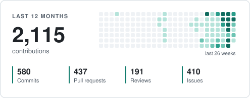
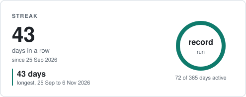

## Peter Dike

PhD candidate in medical image analysis at the University of Bern, building open health
software with the Open Science Foundation. I like software you can check: open models that
run locally, answers that show their sources, and evaluations that measure where a model
fails.

[peterdike.ch](https://peterdike.ch)

### Now

- **[TwinLLM](https://github.com/Opening-Science/twin-llm)**: ask research questions about
  health data with open language models, side by side, and see which numbers each answer
  used. Local-first, synthetic people by default, research use only.
- **[OpenTwin](https://github.com/Opening-Science/open-twin)**: TypeScript libraries that turn
  wearable and health data into FHIR R4, with
  [synthetic Synthea cohorts](https://github.com/Opening-Science/opentwin-synthea) and a
  [3D body viewer](https://github.com/Opening-Science/open-twin-xr) built on open anatomy.
- **[Bern Life](https://github.com/CPD9/bern-life)**: a research and expertise navigator for
  Bern on the Swiss open model Apertus. Every fact it shows is a sentence from a public page,
  checked in code.
- **[Healthcare Digital Twin](https://github.com/CPD9/Healthcare-Digital-Twin)**: future
  health trajectories from a short questionnaire, a Monash University research project.

### What I work with

| Area                      | Tools and methods                                                                                          |
| ------------------------- | ---------------------------------------------------------------------------------------------------------- |
| Medical image analysis    | PyTorch, CNN segmentation (brain tumours, cervical spine fractures), quantum neural networks with OpenVINO |
| Language models           | Local open models (Ollama, Apertus, Qwen), tool calling, evaluation harnesses, guardrails, cited answers   |
| Health data               | FHIR R4, Synthea, wearables (Oura, WHOOP, Google Health), IHME GBD estimates                               |
| Product engineering       | TypeScript, Next.js, React, Tailwind CSS, Bun, PostgreSQL with Prisma, Hono, Three.js and WebXR            |
| Data science              | Python, pandas, scikit-learn, Jupyter                                                                      |
| Privacy and verifiability | Local-first design, encryption at rest, hash-chained audit logs, signed anchors, SBOMs                     |

### Activity

  <picture>
    <source media="(prefers-color-scheme: dark)" srcset="assets/year-dark.svg">
    
  </picture>
  <picture>
    <source media="(prefers-color-scheme: dark)" srcset="assets/streak-dark.svg">
    
  </picture>

Drawn once a day from the GitHub API by <a href="scripts/cards.py">scripts/cards.py</a>; nothing third-party loads when you open this page.
