## Hi there, I'm Peter! 👋

About Me 🚀

Software engineer and tech entrepreneur with expertise in AI, blockchain, and digitalization. Passionate about building impactful solutions and pushing innovation forward. Currently contributing to open-source projects with the Open Science Foundation (OSF) 👨🏽‍💻 and a PhD candidate in Medical Image Analysis at the University of Bern 🏥🏙️ 

<picture>
  <source media="(prefers-color-scheme: dark)" srcset="assets/dashboard-dark.svg">
  
</picture>

